# **ArchPilot — AI-Powered Software Architecture Decision Engine**

**Turning application requirements into explainable, data-driven software architecture decisions.**

An AI-assisted architecture decision-support system that transforms natural-language application requirements into structured inputs, evaluates architectural alternatives using deterministic scoring, and explains the trade-offs behind each recommendation.

**Tech Stack:** React 19 · TypeScript · Python · FastAPI · Pydantic · Groq · Pytest


---

## Overview

Choosing the right software architecture is an important engineering decision.

A monolithic architecture may be suitable for an early-stage application, while a high-traffic distributed platform may require a more scalable architecture. However, adopting complex architectural patterns too early can introduce unnecessary infrastructure costs, operational overhead, and maintenance challenges.

**ArchPilot helps make this decision more structured and explainable.**

Users describe their application requirements in natural language. The system uses an LLM to extract relevant requirements, validates the extracted information using Pydantic, and evaluates architectural alternatives through a deterministic weighted scoring engine.

The system currently evaluates three architecture patterns:

- Monolithic Architecture
- Modular Monolith Architecture
- Microservices Architecture

The objective is not simply to recommend an architecture, but to explain why an option may be more suitable and what trade-offs it introduces.

## Problem Statement

Architecture decisions are often made using incomplete requirements, assumptions, or subjective preferences.

This can lead to:

- Selecting architectures that do not match expected traffic.
- Introducing unnecessary distributed-system complexity.
- Overlooking infrastructure and budget constraints.
- Ignoring development team size and operational capabilities.
- Difficulty explaining why one architecture is more suitable than another.

ArchPilot addresses these challenges through structured requirement extraction, architecture evaluation, and explainable recommendations.

## Key Features

### 1. AI-Powered Requirement Extraction

Accepts natural-language application descriptions and uses an LLM to extract structured system requirements.

### 2. Structured Requirement Validation

Uses Pydantic models to validate extracted requirements before passing them to the decision engine.

### 3. Deterministic Architecture Scoring

Evaluates supported architecture patterns using predefined weighted criteria rather than relying entirely on AI-generated recommendations.

### 4. Explainable Recommendations

Presents architecture scores, confidence indicators, decision strength, risk information, and supporting reasoning.

### 5. Architecture Comparison

Compares Monolithic, Modular Monolith, and Microservices architectures to understand their relative suitability.

### 6. What-If Analysis

Allows users to modify application requirements and evaluate how changes influence architecture recommendations.

### 7. Saved Analyses

Provides an interface to review previously saved architecture analyses.

### 8. Architecture Visualization

Displays logical architecture components with meaningful labels and descriptions based on the selected architecture pattern.

---

## Application Screenshots

### 1. Homepage

Users can describe application requirements or select an example scenario to begin an analysis.

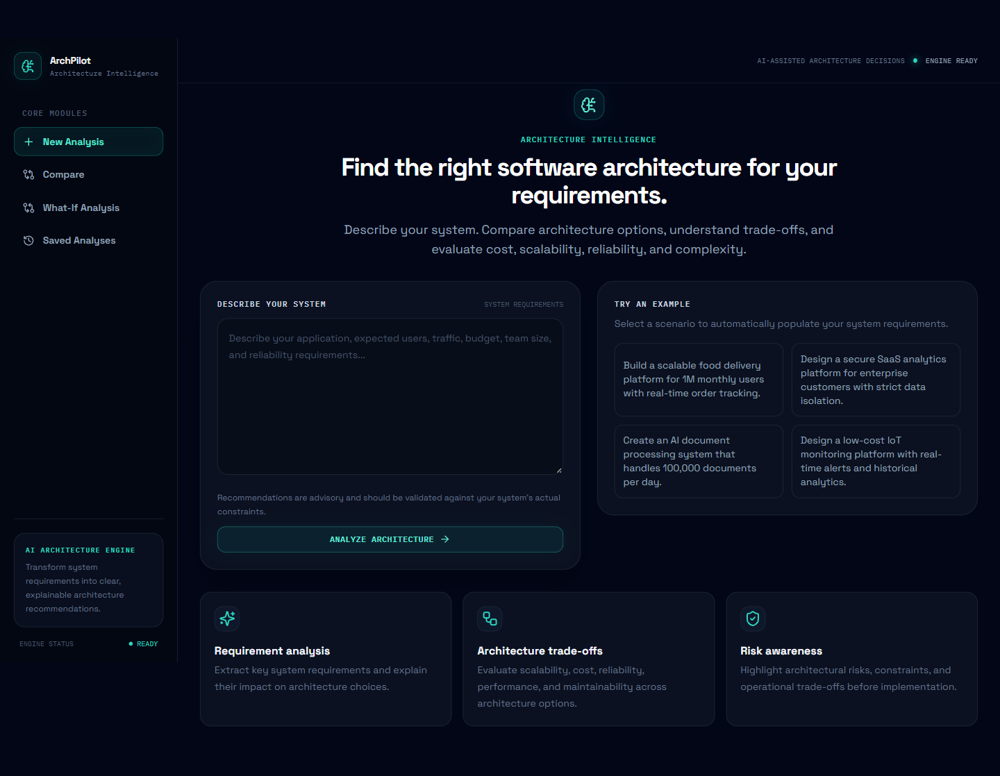

### 2. Architecture Analysis Results

Displays the recommended architecture, overall score, confidence, risk assessment, technical characteristics, and architecture visualization.

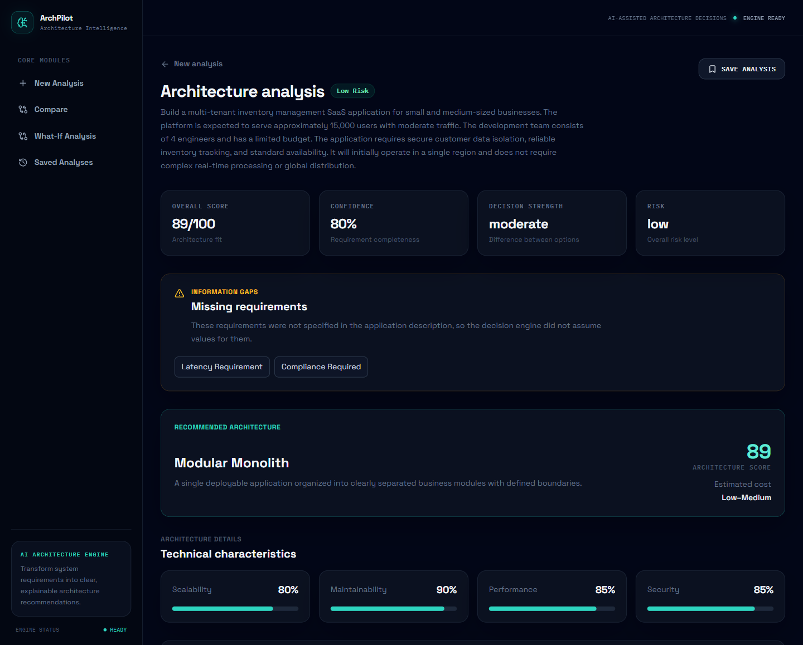

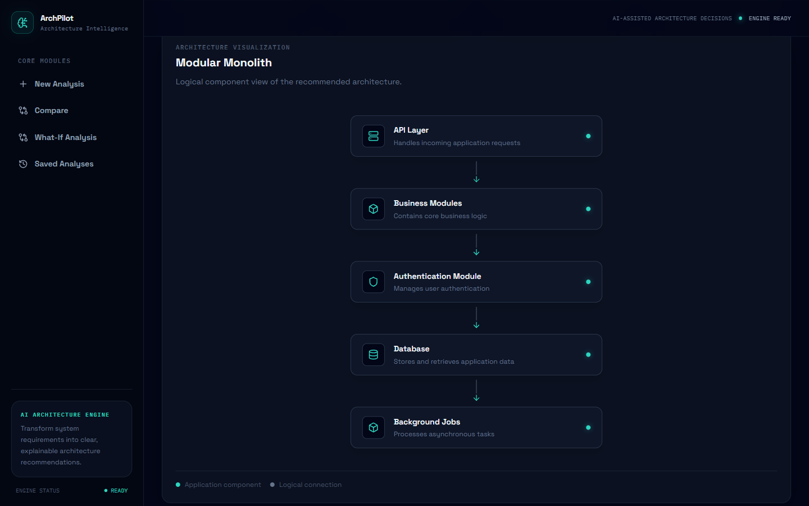

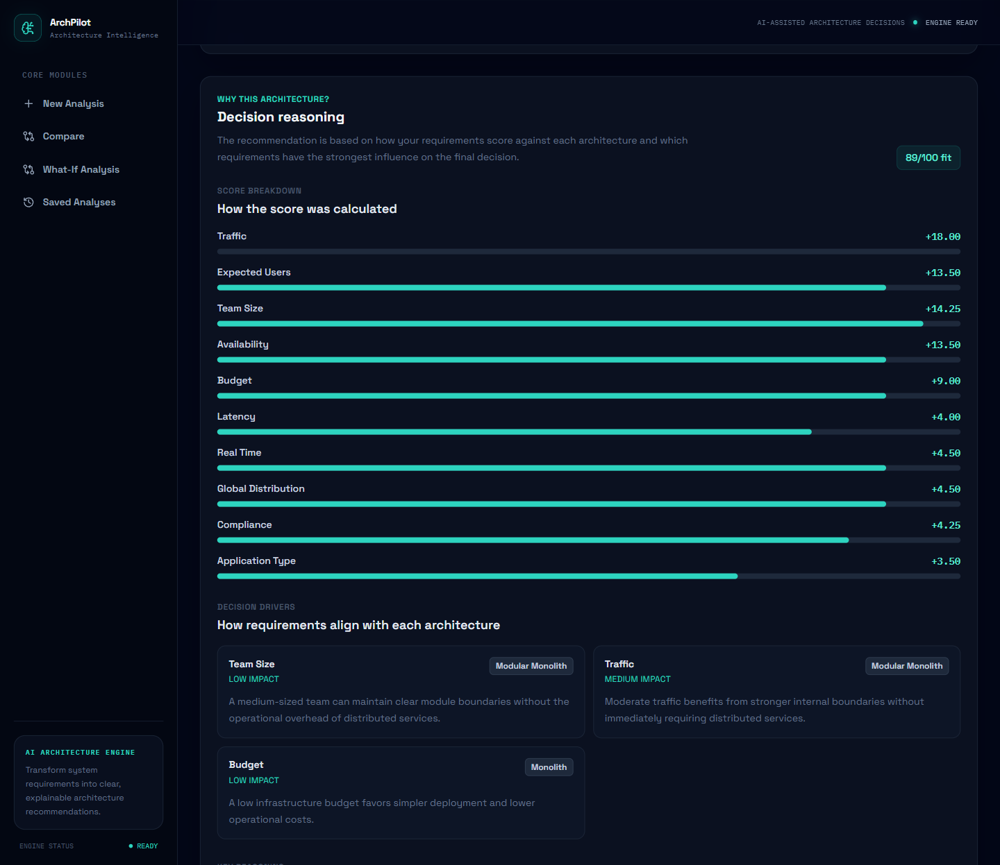


### 3. Architecture Comparison

Compare architecture alternatives across their evaluation scores and technical characteristics.

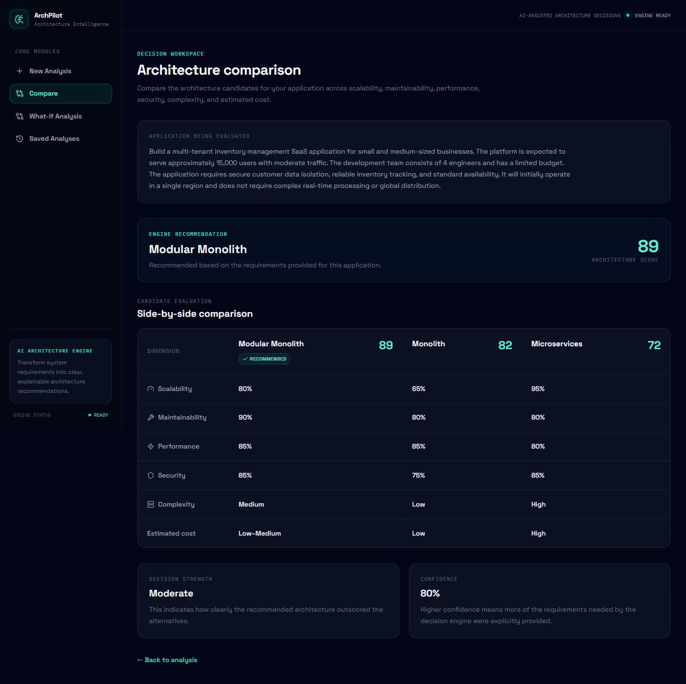

### 4. What-If Analysis

Modify application requirements and explore how different system conditions affect architecture recommendations.

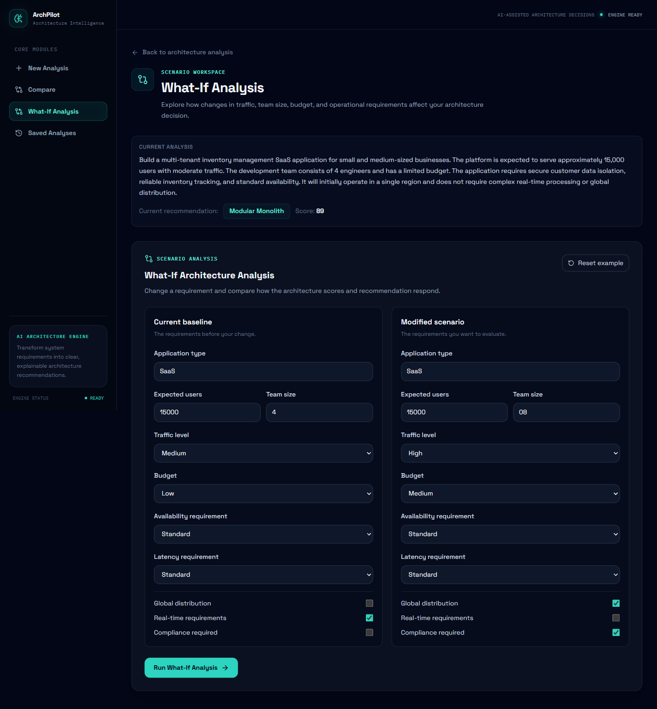

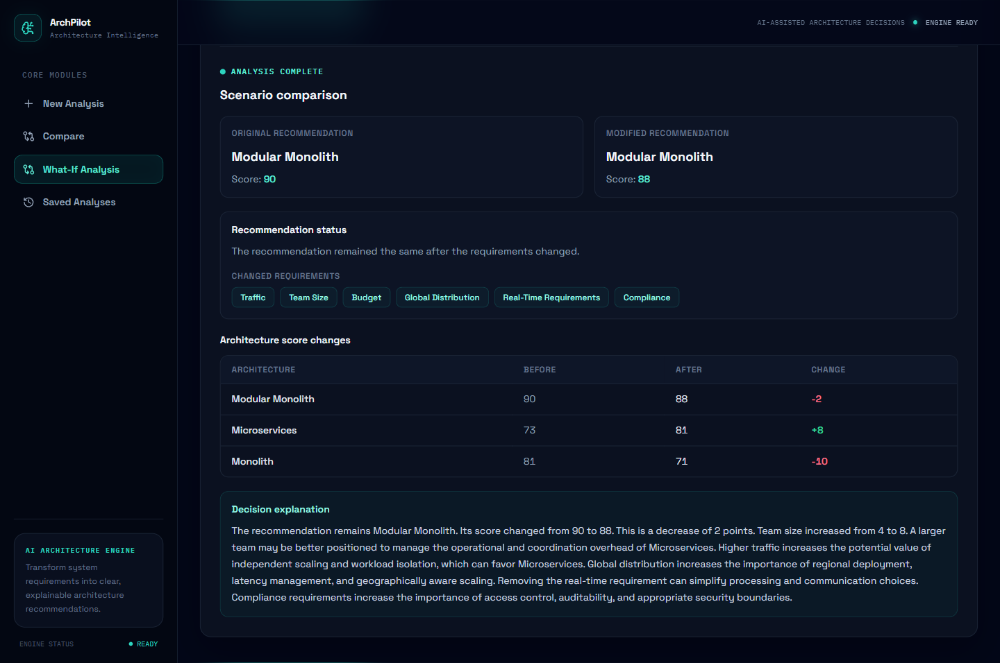

### 5. Saved Analyses

Review and manage previously generated architecture analyses.

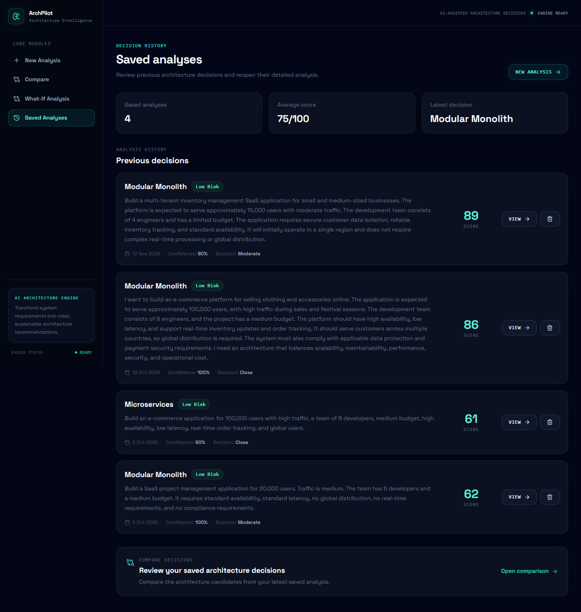

### 6. Decision Reasoning

Explore scoring breakdowns, decision drivers, technical reasoning, risks, and alternative architecture options.

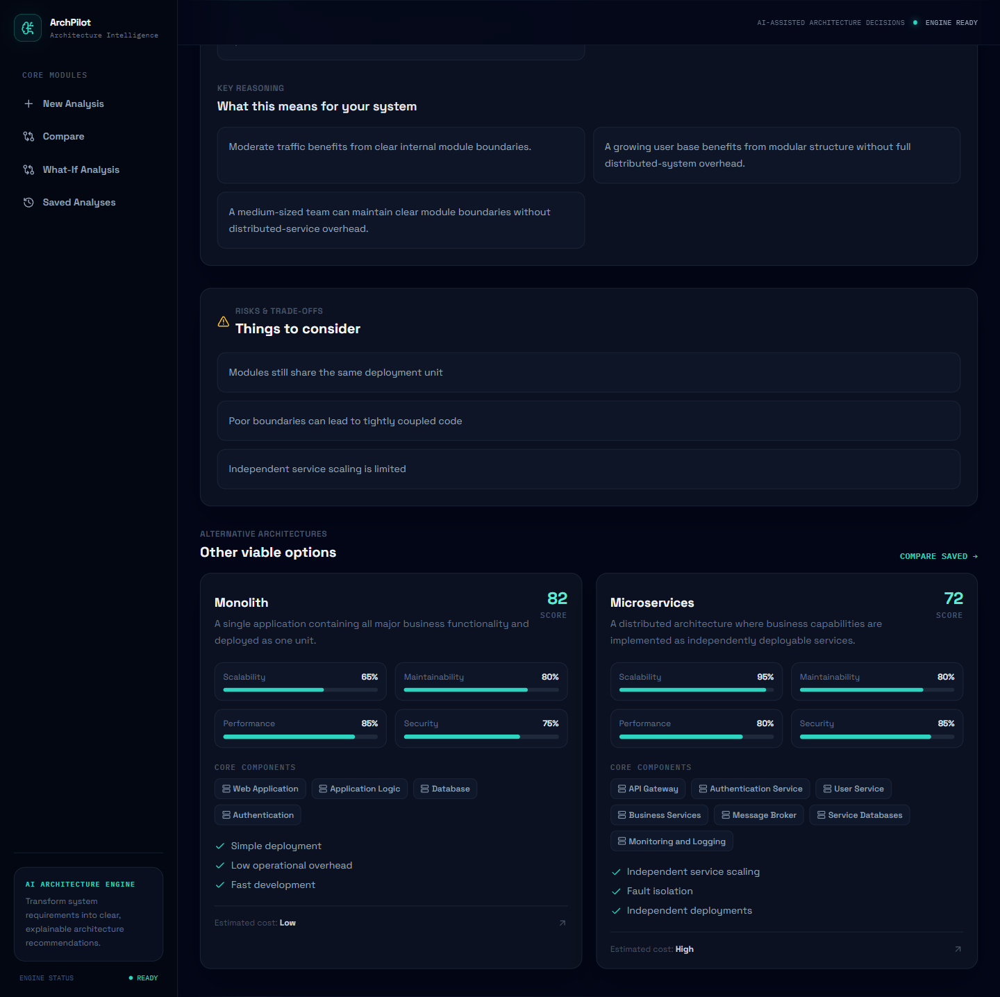

---

## How It Works

ArchPilot follows a hybrid AI and deterministic decision-making pipeline.

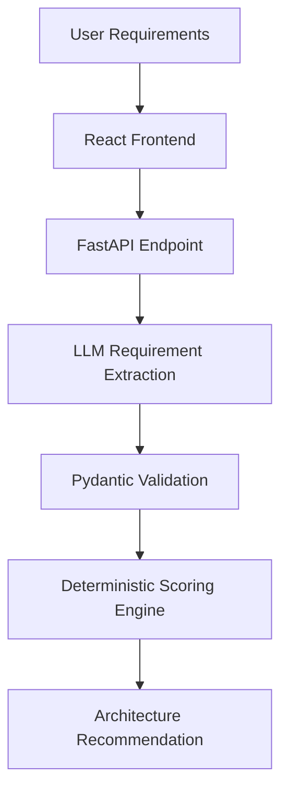

### Decision Pipeline

**Step 1 — Requirement Input**

The user describes an application, including expected users, traffic, budget, team size, and system requirements.

**Step 2 — AI-Based Extraction**

The LLM interprets the application description and extracts relevant structured requirements.

**Step 3 — Validation**

Extracted requirements are validated using Pydantic models to ensure that the decision engine receives structured input.

**Step 4 — Architecture Evaluation**

The deterministic scoring engine evaluates the available architecture patterns using predefined criteria and weights.

**Step 5 — Recommendation**

The application presents architecture recommendations, scores, confidence information, and supporting reasoning.

**Step 6 — What-If Analysis**

Users can modify requirements and evaluate alternative architectural decisions.

---

## System Architecture

ArchPilot separates natural-language understanding, data validation, architecture evaluation, and presentation into distinct responsibilities.

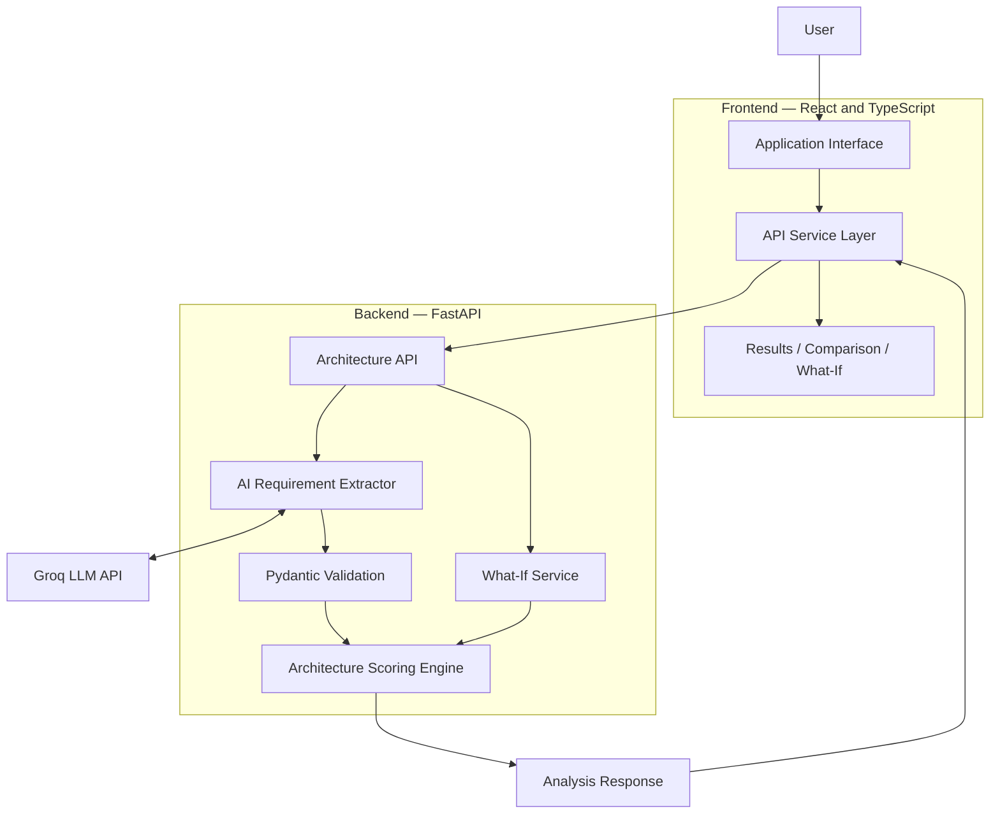

---

## Architecture Evaluation

ArchPilot currently supports three architecture patterns.

| Architecture     | Complexity | Estimated Cost | Primary Characteristics                           |
| ---------------- | ---------- | -------------- | ------------------------------------------------- |
| Monolith         | Low        | Low            | Simplicity and low operational overhead           |
| Modular Monolith | Medium     | Low–Medium     | Clear module boundaries and maintainability       |
| Microservices    | High       | High           | Independent deployments and service-level scaling |

### Evaluation Criteria

The scoring engine considers application requirements such as:

- Expected users
- Traffic intensity
- Development team size
- Budget constraints
- Availability requirements
- Latency expectations
- Real-time processing
- Global distribution
- Compliance requirements

Architecture profiles also define characteristics, strengths, risks, and logical components.

**Important:** Scores are comparative decision-support indicators based on the implemented evaluation logic. They are not guarantees of real-world performance or production benchmarks.

---

## Engineering Decisions

### Why Combine AI with Deterministic Scoring?

A purely LLM-driven recommendation system can produce inconsistent results for similar inputs.

ArchPilot separates requirement understanding from architecture evaluation.

| Component                   | Responsibility                                            |
| --------------------------- | --------------------------------------------------------- |
| AI Requirement Extractor    | Interprets natural-language requirements                  |
| Pydantic Models             | Validates structured requirements                         |
| Architecture Scoring Engine | Evaluates architecture alternatives                       |
| Architecture Profiles       | Defines characteristics, strengths, risks, and components |
| What-If Service             | Re-evaluates modified requirements                        |

This separation makes the decision process more transparent, testable, and easier to extend.

### Why Modular Monolith?

The Modular Monolith is treated as a distinct architecture option rather than simply a smaller version of Microservices.

It provides clearly separated business modules while retaining a single deployment unit.

This makes it an important alternative for applications that need maintainability without immediately accepting the operational complexity of distributed services.

---

## Technology Stack

| Layer           | Technologies         |
| --------------- | -------------------- |
| Frontend        | React 19, TypeScript |
| Build Tool      | Vite                 |
| Styling         | Tailwind CSS         |
| Icons           | Lucide React         |
| Backend         | Python, FastAPI      |
| Data Validation | Pydantic             |
| AI Integration  | Groq API             |
| AI Model        | GPT-OSS-120B         |
| Testing         | Pytest               |

---

## Project Structure

```text

ArchPilot-ai-architecture-decision-engine/
│
├── backend/
│   ├── app/
│   │   ├── api/
│   │   ├── engine/
│   │   ├── models/
│   │   ├── schemas/
│   │   ├── services/
│   │   ├── config.py
│   │   └── main.py
│   │
│   ├── tests/
│   │   ├── test_analyze.py
│   │   ├── test_extraction.py
│   │   ├── test_scoring.py
│   │   ├── test_validation.py
│   │   └── test_what_if.py
│   │
│   ├── .env.example
│   ├── pytest.ini
│   └── requirements.txt
│
├── frontend/
│   ├── src/
│   │   ├── components/
│   │   ├── lib/
│   │   ├── pages/
│   │   ├── services/
│   │   ├── types/
│   │   ├── utils/
│   │   ├── App.tsx
│   │   ├── index.css
│   │   └── main.tsx
│   │
│   ├── .env.example
│   ├── package.json
│   ├── package-lock.json
│   └── vite.config.ts
│
├── docs/
│   └── screenshots/
│
├── .gitignore
└── README.md

```

---

## Getting Started

### Prerequisites

- Python compatible with the backend dependencies
- Node.js and npm
- Git
- Groq API key

### 1. Clone the Repository

```bash
git clone https://github.com/RiyaJadhav01/ArchPilot-ai-architecture-decision-engine.git

cd ArchPilot-ai-architecture-decision-engine
```

### 2. Backend Setup

Navigate to the backend directory:

```bash
cd backend
```

Create a virtual environment:

```bash
python -m venv venv
```

Activate it on Windows:

```powershell
.\venv\Scripts\Activate.ps1
```

Install dependencies:

```bash
pip install -r requirements.txt
```


Configure the backend environment:

```powershell
Copy-Item .env.example .env
```

Open `backend/.env` and add your Groq API key:

```env
LLM_PROVIDER=groq
LLM_MODEL=openai/gpt-oss-120b
GROQ_API_KEY=your_groq_api_key_here
```

Keep your API keys private. Never commit `.env` files or credentials to GitHub.

Start the backend:

```bash
uvicorn app.main:app --reload
```

Backend URL:

`http://127.0.0.1:8000`

Interactive API documentation:

`http://127.0.0.1:8000/docs`

### 3. Frontend Setup


### 3. Frontend Setup

Open a separate terminal from the project root:

```powershell
cd frontend
```

Configure the frontend environment:

```powershell
Copy-Item .env.example .env
```

Install dependencies:

```bash
npm install
```

Start the frontend:

```bash
npm run dev
```

Frontend URL:

`http://localhost:5173`

---

## API

### Analyze Architecture

**Endpoint:** `POST /api/v1/architecture/analyze`

Accepts application requirements and returns architecture analysis results.

The frontend communicates with the backend through the API service layer.

Interactive API documentation is available at:

`http://127.0.0.1:8000/docs`

---

## Testing

Backend tests are implemented using Pytest.

Run the test suite from the backend directory:

```bash
pytest -v
```

---

## Current Limitations

- Recommendations depend on the quality and completeness of extracted requirements.
- The scoring engine evaluates supported architecture patterns using predefined criteria and weights.
- Architecture scores are comparative indicators, not measured production benchmarks.
- Recommendations should be reviewed against application-specific technical and business constraints.

## Future Improvements

- Additional architecture patterns and evaluation criteria.
- More detailed infrastructure cost estimation.
- Improved architecture trade-off explanations.
- Architecture decision history and versioning.
- Benchmarking and evaluation of recommendation quality.
- Expanded observability and testing capabilities.

---

## Project Status

**Active Development**

ArchPilot explores how AI-assisted requirement understanding can be combined with deterministic engineering logic to support more structured software architecture decisions.


## Author

**Riya Jadhav**

Computer Science Undergraduate

- GitHub: [Riya Jadhav](https://github.com/RiyaJadhav01)
- Project Repository: [ArchPilot](https://github.com/RiyaJadhav01/ArchPilot-ai-architecture-decision-engine)

---

**ArchPilot**

*Better architecture decisions start with better requirement analysis.*

